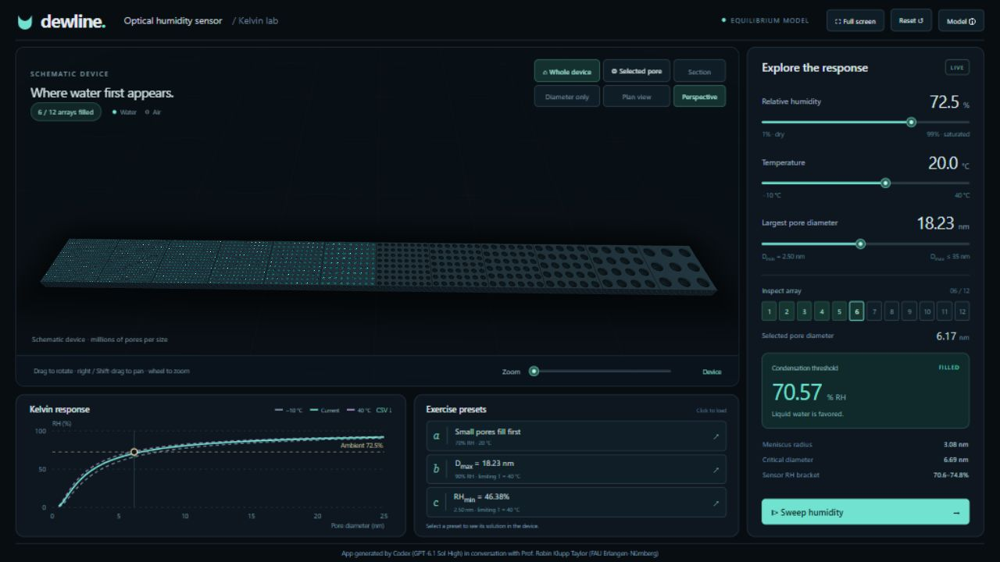

# Dewline — Where Water First Appears

Dewline is a 3D teaching app for capillary condensation in an optical humidity sensor. Change the humidity, temperature and pore size to see which arrays fill and how the Kelvin response changes. The app includes three worked exercise presets.

| Branch | Cloudflare address |
| --- | --- |
| `main` | https://dewline.ipt-apps.workers.dev/ |
| `dev` | https://dev-dewline.ipt-apps.workers.dev/ |



## Build and check

Use Node.js 22 or later. The build and checks require no dependency installation.

```sh
npm test
npm run build
```

The deployable site is in `build/deploy/`. Serve that directory with a static HTTP server for local browser testing. The 3D view requires WebGL with instanced rendering support.

`npm run build -- --baseline` writes the original, unversioned assets to `build/baseline/` for byte comparison. The normal deployment build adds the package version to the footer.

## Deployment

Connect the repository to Cloudflare Workers Builds with `main` as the production branch. Use `npm run build` to build, `npx wrangler deploy` to deploy production, and `npx wrangler preview` for branch previews. Make changes on `dev` and merge to `main` when ready to release.

Dewline is distributed under the MIT License. It uses system fonts and contains no bundled font files.
